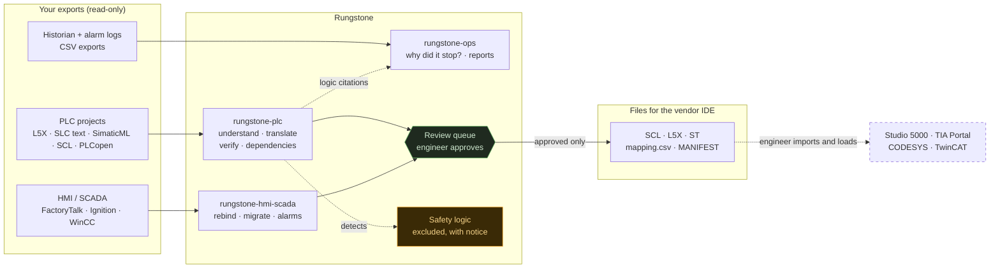
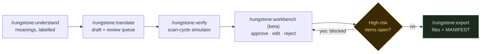
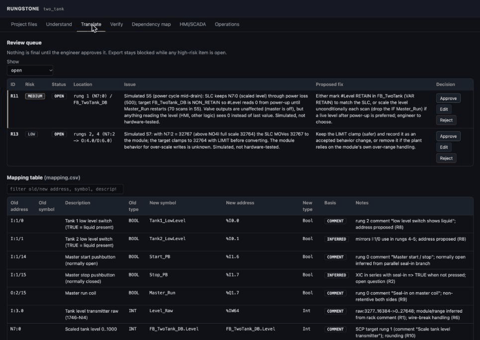
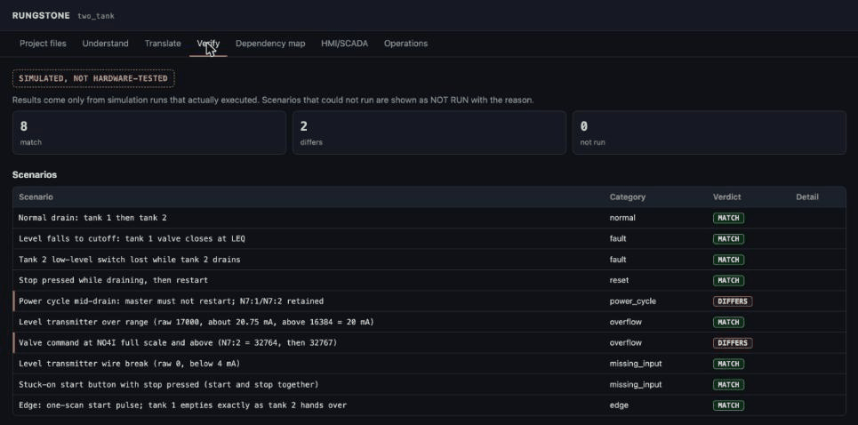

# Rungstone

**Rungstone** is a Claude plugin for industrial controls engineers. It reads PLC, HMI and SCADA
exports and helps you **understand, translate, verify, and map dependencies** in control logic
across vendors, carry that work through to **HMI/SCADA** screens, tags and alarms, and
**troubleshoot stops offline** from exported historian data.

It is read-only and offline by design. Rungstone produces files for the vendor IDE; the engineer
reviews them, approves every flagged change, and loads them.



Nothing in this picture talks to a live controller. The last arrow is the engineer, using the vendor tool.

## Safety and trust rules

These rules hold in every skill, command and script:

1. **Read-only.** Rungstone never connects to or writes to a running controller, device, or network
   address. Outputs are files for Studio 5000, TIA Portal, CODESYS, TwinCAT or the HMI tool, and the engineer loads them. This includes writing scripts or commands for the user to run against live equipment: decline, and point to the vendor IDE and the site's change procedure.
2. **Safety logic is excluded.** Safety-rated logic is detected and excluded from every workflow,
   with a visible notice. That covers e-stops, safety relays, GuardLogix safety tasks and `Class="Safety"`,
   Siemens F-blocks, PLCopen `SF_*` blocks and TwinSAFE. Standard logic that reads a safety status is kept and flagged.
3. **No unearned "verified".** Behavior is never called verified unless a simulation actually ran.
   Every result is labelled **"simulated, not hardware-tested."**
4. **Every meaning is labelled** `confirmed`, `comment`, `io_map`, `inferred` or `unknown`. A guess
   is never presented as fact.
5. **The engineer approves** every flagged change (review queue: approve / edit / reject) before export.
   Export is blocked while any high-risk item is open.
6. **Scope and cost are shown** before any large job.
7. **Parse only.** Nothing from customer files is ever executed. XML is parsed with defusedxml when
   available, otherwise with a guard that refuses any DTD/entity declaration. **Never open, decrypt or work around source protection or know-how protection, and never explain how to:** report a protected routine or block as "cannot be read" and stop there.

## Intended use and responsibility

Rungstone is an engineering aid for **qualified controls engineers**. It is not a certified tool and does
not replace engineering judgement, testing or commissioning.

- **Everything it produces is a draft.** Translated code, rebinds, alarm rationalizations and troubleshooting
  conclusions must be reviewed, compiled, tested offline and commissioned by a qualified engineer before
  they are used. The engineer of record stays responsible for what is loaded into a controller or HMI and
  for compliance with site procedures, codes and standards.
- **Not for safety functions.** Safety-rated logic is excluded on purpose. Rungstone must not be used to
  design, translate, verify or troubleshoot safety functions. Those need functional-safety engineering
  (for example IEC 61508, IEC 62061, ISO 13849) and validation on the target by a qualified safety engineer.
- **"Simulated" is not "tested".** The scan-cycle simulator models the logic, not the hardware, I/O, timing
  or process. A match in simulation says nothing about behavior on a real machine.
- **Your right to use the code.** Only use Rungstone on PLC, HMI and historian files you are allowed to
  analyse, copy and modify. Projects often belong to the plant owner or an OEM, and contracts or source
  protection may restrict them. That includes add-on instructions and library blocks supplied by a vendor, an
  OEM or a third party, which have their own license terms: Translate flags code that looks like library code
  as a high-risk review item, so you confirm its license allows porting before it is exported. Rungstone does
  not open source-protected routines or blocks; it reports that they cannot be read.

The software is provided under the MIT license, "as is", without warranty of any kind (see [LICENSE](LICENSE)).

## What's inside

| Component | What it does |
|---|---|
| `skills/rungstone-plc` | **Phases 1–2: PLC.** Understand (summary, machine sequence by rung, signal table with evidence, open questions). Translate to S7-1500 SCL, Rockwell Logix L5X, or IEC Structured Text, with `mapping.csv` and a ranked review queue. Verify with scenario plans plus a pure-Python scan-cycle simulator that compares source and target scan by scan. Dependency map of readers, writers and conflicts across PLC + HMI + SCADA. |
| `skills/rungstone-hmi-scada` | **Phase 3: HMI/SCADA.** Explain screens, buttons, indicators and scripts. Retarget bindings with `mapping.csv`. Migrate tag databases, scripts and alarms (screens as draft layouts only). Verify bindings. Check consistency across PLC + HMI + SCADA. Clean up alarms from alarm history (ISA-18.2 style: floods, chattering, standing alarms, priorities, response text). |
| `skills/rungstone-ops` | **Phase 4: operations, offline.** Find why a line stopped from historian/alarm exports plus the PLC logic (cause, evidence, logic cited, what to check first, what wasn't checked). Answer plant questions with a chart. Build shift and downtime reports. |
| `commands/` | `/rungstone:understand` `/rungstone:translate` `/rungstone:verify` `/rungstone:dependencies` `/rungstone:hmi` `/rungstone:alarms` `/rungstone:troubleshoot` `/rungstone:report` `/rungstone:workbench` (beta) `/rungstone:export` |
| `hooks/` | Guardrails: block `/rungstone:export` while high-risk items are open; block device/network write actions; warn when a file read or written looks like safety logic. |
| `shared/` | Safe XML parsing, `.rungstone/` state, export, workbench UI, JSON schemas. Vendored into each skill's `scripts/_shared/` so every skill also works standalone. |
| `mcp/historian` | **Optional** read-only historian connector (SQLite, CSV, ODBC, OPC UA). **Off until you configure it** in the plugin settings. See below. |
| `evals/`, `fixtures/`, `tests/` | Test cases per skill, small sample files, and the unit tests. |

## Supported formats

| In | Out |
|---|---|
| Rockwell Studio 5000 / RSLogix 5000 `.L5X` (full or partial; RLL, ST, FBD, SFC, AOIs, UDTs, I/O module comments) | S7-1500 SCL source (`.scl`) + tag table rows |
| RSLogix 500 / PLC-5 ladder text (ASCII export `SOR … EOR`, or neutral text) | Rockwell Logix partial-export `.L5X` |
| Siemens TIA Portal SimaticML `.xml` (SCL, LAD/FBD summarized, STL, DBs, tag tables, UDTs) and SCL source `.scl` | IEC 61131-3 Structured Text (`.st`, or PLCopen XML) |
| PLCopen XML (CODESYS, Beckhoff, Beremiz), TwinCAT `.TcPOU/.TcGVL/.TcDUT`, IEC ST source | `mapping.csv`, review queue, verification results |
| I/O lists (CSV; XLSX when `openpyxl` is installed) | HMI/SCADA rebind reports, draft tag/alarm databases |
| HMI/SCADA: FactoryTalk View exports, Ignition JSON/XML, WinCC exports, tag CSVs, scripts (read as text) | Dependency maps, alarm reports, troubleshooting and downtime reports |
| Historian and alarm/event CSV exports | Charts (PNG with matplotlib, otherwise SVG) |

Binary projects (`.ACD`, `.RSS`, `.ap1x`, `.project`) can't be read. Rungstone explains how to export them.

## Install

**Claude Code** (this repo is also a plugin marketplace):

```
/plugin marketplace add arunvenkatadri/rungstone
/plugin install rungstone@rungstone
```

**claude.ai / Cowork:** download a standalone skill package from the releases (`rungstone-plc.skill`,
`rungstone-hmi-scada.skill`, `rungstone-ops.skill`) and upload it in Settings > Capabilities > Skills.
Outside Claude Code the workbench (beta) is generated as a single self-contained HTML page, and approvals
happen in chat ("approve R1, R3; reject R2: reason").

Requirements: Python 3.9+ (standard library only). Optional: `defusedxml`, `openpyxl` (XLSX), `matplotlib` (PNG charts).

## How a project works

Rungstone keeps its state in `.rungstone/` inside your project folder. Everything is a plain file, so it works with git:

```
.rungstone/
  project.json         sources (path + sha256), target platform
  tagmap.json          shared tag map: meaning, basis, new name (reused by every skill)
  mapping.csv          old -> new address/symbol table
  review_queue.json    flagged changes and your decisions
  verify_results.json  simulation results ("simulated, not hardware-tested")
  dependencies.json    readers, writers, conflicts
  decisions.log        append-only audit trail
```

Typical flow:



The workbench (**beta**) is a local page (127.0.0.1 only) that shows the review queue, the mapping table,
the verification results and the dependency conflicts:





## What runs, and data handling

- **Claude sees your files.** Rungstone runs inside Claude. Any file content, script output or report that
  Claude reads becomes part of your conversation and is sent to Anthropic for processing under the terms of
  your Claude plan, like anything else you share with Claude. Before you use Rungstone on a project, check
  that this is allowed by your customer contracts, NDAs, site rules and any export-control obligations
  (for example defense, nuclear or other controlled work). If it isn't, don't load those files.
- **The scripts run locally.** The Python scripts in `skills/*/scripts/` run on your machine on files you
  provide. They write results to `.rungstone/`, `out/` and `export/` in your project folder and print compact
  JSON, so Claude reads summaries rather than whole projects where it can.
- **The scripts make no network connections**, with one opt-in exception. No script opens an outbound connection, sends telemetry or fetches
  anything. The exception is the historian connector, and only after you enable it in the plugin settings: it then makes read-only
  queries to the historian you configured, and to nothing else.
- **The workbench** (`shared/workbench/server.py`) binds to `127.0.0.1` only (any other address is refused),
  uses a per-session CSRF token, and serves only the local state files.
- **Hooks** (`hooks/scripts/*.py`) read the hook event JSON and local `.rungstone/review_queue.json`, and
  return allow/deny decisions or a warning. They send nothing anywhere. The network guard always blocks
  PLC/fieldbus client libraries, device-write calls, and write-type MCP tools on plant-system servers. Inside an Rungstone project
  (a folder containing `.rungstone/`), it also blocks remote shells, HTTP uploads,
  raw sockets and Windows script hosts. It doesn't change permission settings.
- **Customer files are never executed.** HMI/SCADA scripts are parsed as text.

## Optional historian connector (read-only MCP server)

`mcp/historian/` is a small, read-only MCP server for querying historian data: a SQLite file, a folder of CSV
exports, SQL historian tables over ODBC, or OPC UA values and history. It ships with the plugin but is
**off by default**. Until you set **Historian connector config** in the plugin settings to a config file with
`"enabled": true`, it offers no tools and connects to nothing.

- **No write capability of any kind.** There's no raw SQL from the model, only parameterized SELECTs on
  read-only connections, and OPC UA does reads only.
- **Credentials only from plugin settings.** ODBC connection strings and OPC UA passwords are entered in the
  plugin settings (Claude Code `userConfig`, kept in your OS secure credential store) and passed only to this
  connector. Nothing is read from your environment, and credentials never go in the config file.

> **Get approval from plant IT/OT before you enable it.** Connecting any tool to plant systems must follow your
> site's OT security policy. See `mcp/historian/README.md`.

Live monitoring isn't part of this version. The ops skill works on exported data.

## Limits

- Static analysis sees only the files you supply. Indirect addressing, pointers and communications instructions can hide readers and writers.
- The simulator approximates standard instructions only. These include contacts, coils, latches, one-shots, TON/TOF/RTO,
  CTU/CTD, moves, compares, basic math, and ST IF/CASE/assignments. Vendor-specific instructions (PID, motion,
  messaging, file/sequencer) show as **"not run"**. It does not model asynchronous I/O or exact task timing.
  Results are **simulated, not hardware-tested**.
- SimaticML LAD/FBD and L5X FBD networks are summarized, so topology may be approximate.
- Translations are drafts. Analog scaling, PID, motion, retentive memory, fault behavior and protocols always go to the review queue.
- Safety-rated logic is never analysed or translated. It must be engineered and validated by a qualified safety engineer.

## Development

Tests, the shared-code sync, the standalone `.skill` build and plugin validation are described in
[CONTRIBUTING.md](CONTRIBUTING.md).

### Fixtures and rights

Every file in `fixtures/` was written for this repository. None is copied from a vendor, customer, or third-party
project, and all are released under this repository's MIT license:

| Folder | Contents | Origin |
|---|---|---|
| `fixtures/plc/timers_hmi` | Fill-station L5X, FactoryTalk-style tag CSV, IEC ST translation for simulation | authored for Rungstone |
| `fixtures/plc/estop` | GuardLogix-style conveyor cell L5X with a safety program and an e-stop routine | authored for Rungstone |
| `fixtures/plc/unwritten_bit` | CODESYS-style PLCopen XML mixer program | authored for Rungstone |
| `fixtures/plc/two_tank` | SLC 500 two-tank ladder (RSLogix 500 ASCII style), SCL translation, scenarios | authored for Rungstone |
| `fixtures/hmi/*` | FactoryTalk, Ignition, WinCC-style exports, scripts, synthetic alarm history (seeded generator in `gen/`) | authored for Rungstone |
| `fixtures/ops/*` | Pump-station L5X, synthetic historian, alarm and downtime logs (seeded generator in `gen/`) | authored for Rungstone |

### Standards

Rungstone refers to ISA-18.2 / IEC 62682, EEMUA 191, IEC 61131-3 and functional-safety standards by name only.
The guidance in `skills/*/references/` is written in our own words, and the alarm KPI targets are the commonly
published values, which a site's alarm philosophy may override. No text from these standards is reproduced; get
them from ISA, IEC or EEMUA.

## Trademarks

Product and company names used in this project, including the vendor and product names of the PLC, HMI, SCADA
and historian platforms it reads and writes, are trademarks of their respective owners. They are used only to
describe file formats and compatibility. Rungstone is an independent project and is not affiliated with,
sponsored by or endorsed by any of these companies, or by Anthropic.

## License

MIT. See [LICENSE](LICENSE).
